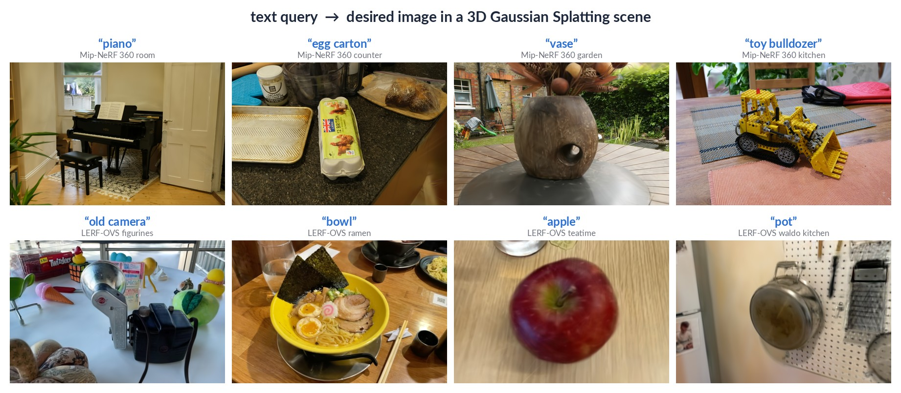
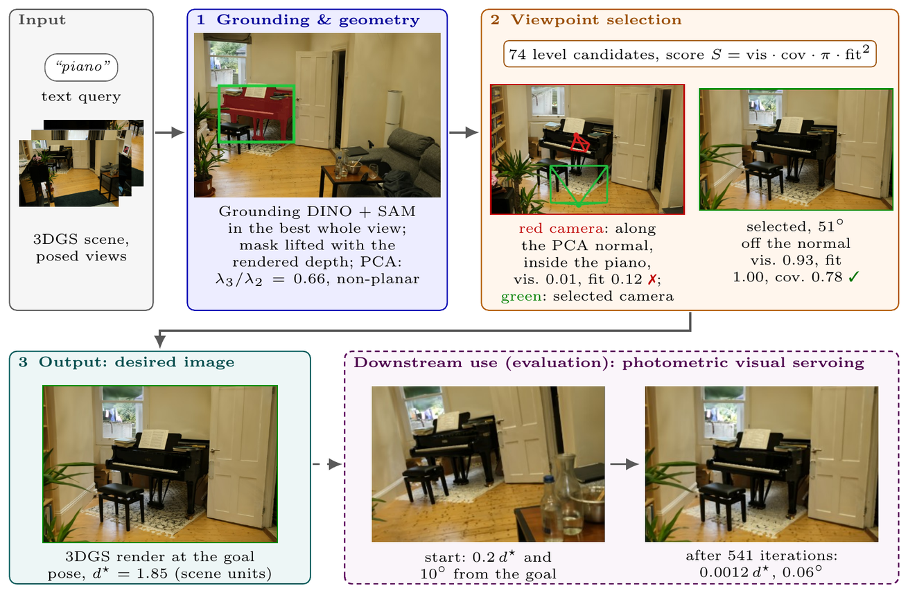

# From Words to Desired Images

Code and evaluation results of the paper *From Words to Desired Images: Language-Specified Goal Views for Visual
Servoing in Gaussian Splatting Scenes* (Mustapha Boughdaoui, Youssef Alj; submitted to Machine Vision and
Applications). Project page: https://text2desired.github.io/



A text query names an object in a scene reconstructed with 3D Gaussian Splatting. The pipeline grounds it (Grounding
DINO + SAM on the training views), lifts it to 3D with the rendered depth (PCA of the object cloud), scores 74
candidate viewpoints by visibility, render reliability, a frontality / broadside prior and whether the whole object
fits with the camera in free space (`S = vis · cov · π · fit²`), and renders the desired image at the chosen pose. A
photometric visual servo is used as a downstream test of the desired images.

```
text query ──► stage 1: localize ──► stage 2: select view ──► desired image + goal pose ──► photometric servo (test)
               Grounding DINO, SAM     74 candidates, S          3DGS render                 Levenberg–Marquardt
               3DGS depth, PCA
```



## Layout

| path | contents |
|---|---|
| `text2goal/` | the method: rendering, perception, geometry, localisation (stage 1), viewpoint selection (stage 2), ground-robot viewpoint, photometric servo |
| `scripts/` | experiments, baselines, statistics, tables and figures of the paper (one script per experiment, `run_*.sh` chain them) |
| `out/` | aggregated results of every evaluation in the paper (csv), from which all tables and tests are regenerated |
| `paper_mva/tables/`, `paper_mva/figures/` | where `paper_tables.py` and `paper_figures.py` write |

Per-run outputs (desired images, goal poses, servo trajectories; several GB) are not included.

## Installation

Tested on Ubuntu with an NVIDIA GPU (24 GB) and a driver for CUDA 11.8 or newer.

```
git clone https://github.com/YoussefAljUM6P/text2desired.git
cd text2desired
conda create -n text2desired python=3.10 -y
conda activate text2desired
pip install torch==2.1.2 torchvision==0.16.2 --index-url https://download.pytorch.org/whl/cu118
pip install "gsplat==1.5.3+pt21cu118" --extra-index-url https://docs.gsplat.studio/whl/pt21cu118
pip install -r requirements.txt
```

SAM ViT-H checkpoint (Grounding DINO and CLIP are downloaded from Hugging Face on first use):

```
mkdir -p checkpoints
wget -P checkpoints https://dl.fbaipublicfiles.com/segment_anything/sam_vit_h_4b8939.pth
```

Check:

```
python -c "import torch, gsplat; print(torch.cuda.is_available(), gsplat.__version__)"   # True 1.5.3+pt21cu118
```

All commands below run from the repository root in this environment.

## Reproducing the tables and statistics

Every number of the paper and the supplementary material comes from the csv files in `out/`:

```
PYTHONPATH=scripts:. python scripts/paper_tables.py      # paper_mva/tables/*.tex
PYTHONPATH=scripts:. python scripts/paper_stats.py       # out/paper_stats.txt: every significance test in the text
PYTHONPATH=scripts:. python scripts/servo_vs_criteria.py # servo success vs desired-image criteria (logistic regression)
```

## Running the method

```
PYTHONPATH=scripts:. python scripts/text_to_desired_image.py --query "piano" \
    --model <gsplat checkpoint .pt or 3DGS .ply> --cfg <gsplat cfg.yml> --images <scene>/images \
    --sam_ckpt checkpoints/sam_vit_h_4b8939.pth --out out/piano
```

`--cfg` is the `cfg.yml` written by gsplat's `simple_trainer.py` (its `data_dir`, `data_factor` and
`normalize_world_space` are read). The models of the paper are trained with gsplat 1.5.3 (MCMC, data factor 1, 30k
iterations; `scripts/train_lerf.sh`). The output directory holds the desired image (`desired_image.png`), the goal pose
and intrinsics (`goal.npz`) and a `summary.json` of every stage.

## Evaluations

| result (`out/`) | script | paper |
|---|---|---|
| `benchmark/lerf_ovs_goals.csv` | `goal_benchmark.py` (ours, B1 training photo, B2 CLIP render-and-score, B3 CapFrame via `capframe_batch.py`) | Table 1, desired-image criteria on LERF-OVS |
| `servo_eval/*_same.csv` | `servo_eval.py`, `run_servo_eval*.sh`, `refview_render.py` | Table 1 servo columns; supplement S1 |
| `servo_eval/lerf_ovs_cross.csv` | `run_servo_eval_cross.sh` | supplement S1 (servo across reconstructions) |
| `servo_eval/mip*_ss4*.csv`, `aliasing_check.csv` | `run_servo_eval_ss.sh`, `mip_baselines.py`, `capframe_mip_runs.py`, `aliasing_check.py` | supplement S1 (Mip-NeRF 360) |
| `benchmark/grounding_hits.csv`, `grounding_3d.csv` | `grounding_hits.py`, `grounding_3d.py`, `langsplat_ground.py`, `gt_ground.py` | grounding analysis; supplement S2 |
| `lerf_ovs*/eval_pairs.csv` | `eval_lerf_ovs.py` | grounding on the LERF-OVS protocol |
| `ablation/lerf_ovs.csv` | `ablation.py` | ablation |
| `sensitivity/*.csv` | `sensitivity.py`, `run_sensitivity.sh` | supplement S3 |
| `interiorgs/*.csv` | `interiorgs_survey.py` → `interiorgs_run.py` → `interiorgs_rescore.py` → `interiorgs_servo.py` | ground robot; supplement S4 |
| `timing.csv` | `timing.py` | runtime |

Videos and figures: `make_videos.py`, `goal_dashboard.py`, `interiorgs_dashboard.py`, `make_gallery.py`,
`paper_figures.py`, `pipeline_figure.py`.

## Data and external code

Data: [LERF-OVS](https://github.com/minghanqin/LangSplat) (scenes and labels), [Mip-NeRF 360](https://jonbarron.info/mipnerf360/),
InteriorGS validation houses with their ObjectNav episodes. The dataset, checkpoint and model paths are set at the top
of each script and in the `run_*.sh` files; change them to your own locations.

The training cameras are read with gsplat's COLMAP parser (`third_party/gs_vs`, Apache 2.0), so that the world
normalisation matches gsplat training. The InteriorGS survey (`interiorgs_survey.py`) runs in a separate
[Habitat-GS](https://github.com/facebookresearch/habitat-sim) environment. CapFrame (baseline B3) is the authors' code,
run in its own environment with a 4-bit model (`capframe_batch.py`).

## License

PolyForm Noncommercial 1.0.0 (`LICENSE`): free for research, teaching and other noncommercial use; contact the authors
for commercial use. `third_party/` keeps its Apache 2.0 license.
